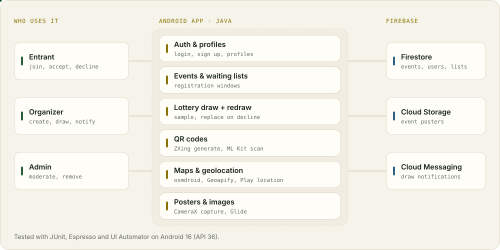

<picture><source media="(prefers-color-scheme: dark)" srcset="assets/hero-dark.svg"><source media="(prefers-color-scheme: light)" srcset="assets/hero-light.svg"></picture>

# EventLottery

**A case study of the Android app my team of six built for CMPUT 301 at the University of Alberta (Winter 2026).**

The source lives in a private team repository, so this page explains what the app does, how it is put together, and which parts I built. I'm glad to walk through the code on a call.

## The problem

Popular community centre programs (swim lessons, youth sports, workshops) open registration and fill up in seconds. Whoever happens to be refreshing the page at the right moment wins, which quietly shuts out people with shift work, disabilities, or anything else that keeps them away from a screen at 9:00 sharp.

## The idea

Instead of a race, registration becomes a window. Entrants join a waiting list any time while it's open. When it closes, the organizer draws a set number of entrants at random. Chosen entrants get a notification and accept or decline; every decline or cancellation lets the organizer draw a replacement from whoever is still waiting. Nobody has to be fastest, they just have to show up.

## How it is built

<picture><source media="(prefers-color-scheme: dark)" srcset="assets/architecture-dark.svg"><source media="(prefers-color-scheme: light)" srcset="assets/architecture-light.svg"></picture>

| Layer | What we used |
| --- | --- |
| App | Java, Android SDK, Material components, RecyclerView |
| Data | Firebase Firestore for events, users and waiting lists; Cloud Storage for event posters |
| Notifications | Firebase Cloud Messaging for selected, not selected and invite alerts |
| QR | ZXing to generate promo codes, ML Kit barcode scanning plus CameraX to read them |
| Location | Google Play location services, osmdroid maps, Geoapify geocoding over OkHttp |
| Testing | JUnit, Espresso and UI Automator, verified on Android 16 (API 36) |

## Features by role

**Entrants** browse, search and filter open events, join or leave a waiting list, open an event straight from its QR code, accept or decline an invitation, keep a profile and event history, and comment on events.

**Organizers** create public events with promo QR codes or private unlisted ones, set registration windows, run the draw and replacement draws, see waiting, invited, cancelled and enrolled lists, upload posters, require geolocation and view where entrants joined from on a map, message each group, export the final list as CSV, and add co organizers.

**Admins** browse and remove events, profiles and images, remove organizers who break policy, and review the log of notifications organizers have sent.

## What I built

I owned the **login and sign up flow** end to end, including the screens and the fixes that came out of testing them. I built the **map view** organizers use to see where entrants joined from, and the **location verifier** that geocodes an entrant's position for events that require geolocation. I added **comment editing**, wired up the **admin profile tab**, fixed **notification alerts** on the organizer side, and cleaned up **event creation** (character limits, date logic, styled pickers). I also pushed the final Part 3 build of the app.

## Team

Built with [Abrar797](https://github.com/Abrar797), [mansib-yeasfi](https://github.com/mansib-yeasfi), [PremGill24](https://github.com/PremGill24), [iamtiolu](https://github.com/iamtiolu) and [yutao17](https://github.com/yutao17).

Diagrams on this page are hand written SVGs. Back to [my profile](https://github.com/tasfikamali-rgb).
